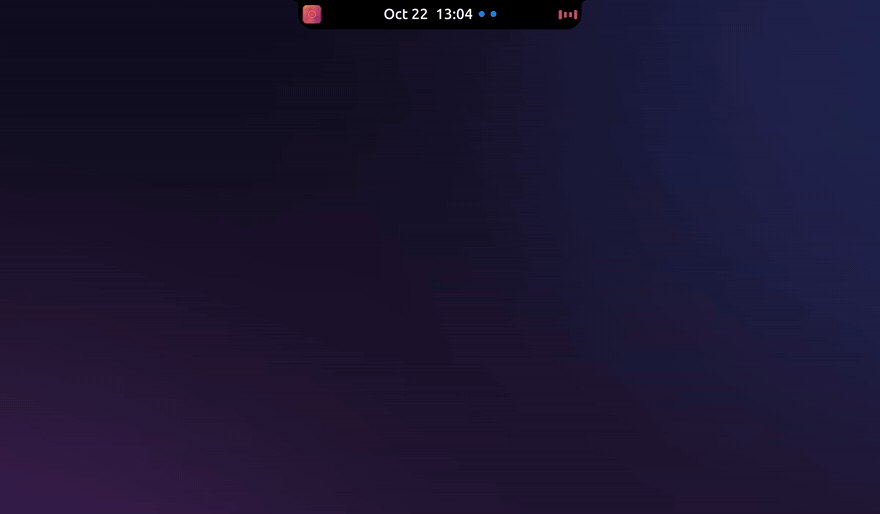
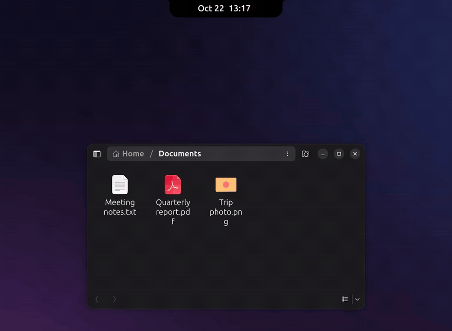
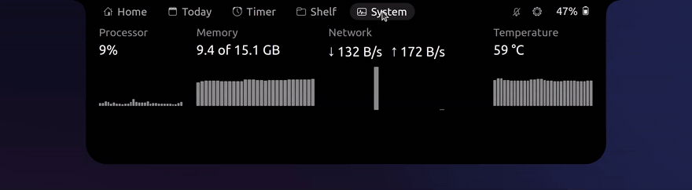

# Boring Notch for GNOME

A Dynamic Island for the GNOME top bar. It's a Linux port of
[boring.notch](https://github.com/TheBoredTeam/boring.notch), rewritten as a
GNOME Shell extension because the original is built on macOS-only frameworks.

The notch sits in the middle of the top bar and springs open when you rest
the pointer on it.



[Watch in full quality (MP4, 60 fps)](docs/media/overview.mp4)

## Demos

| Peeks | Live activities |
|---|---|
|  |  |
| Volume, notifications with their buttons, Caps Lock, Bluetooth, Do Not Disturb. [MP4](docs/media/peeks.mp4) | Timer, meeting countdown, app progress, screen recording. [MP4](docs/media/live.mp4) |
|  |  |
| Drag files onto the notch to keep them on the Shelf. [MP4](docs/media/shelf.mp4) | System tab and synced lyrics, both off by default. [MP4](docs/media/extras.mp4) |

The songs, people and events in the clips are made up. They are recorded
with `tools/demo/demo.sh`, which drives a headless GNOME Shell and records it
with GNOME's own screencast.

## Install

You need GNOME Shell 50 on Wayland (Ubuntu 26.04, Fedora 44, Debian testing).
Check with `gnome-shell --version`; see [Requirements](#requirements) for other
versions.

### From a release (easiest)

1. Download `boring-notch-linux@aatman09.github.io.shell-extension.zip` from the
   [latest release](https://github.com/Aatman09/boring-notch-linux/releases/latest).
2. Install it:

   ```sh
   gnome-extensions install --force boring-notch-linux@aatman09.github.io.shell-extension.zip
   ```

3. Log out and back in (GNOME on Wayland only loads new extensions at login).
4. Enable it:

   ```sh
   gnome-extensions enable boring-notch-linux@aatman09.github.io
   ```

### From source

```sh
git clone https://github.com/Aatman09/boring-notch-linux.git
cd boring-notch-linux
make install
```

Then log out and back in, and enable it as in step 4 above.

### Optional packages

For the music bars to follow the audio (they move on their own without them):

```sh
sudo apt install gstreamer1.0-tools gstreamer1.0-plugins-good   # Ubuntu, Debian
sudo dnf install gstreamer1 gstreamer1-plugins-good                # Fedora
```

### Settings

Right-click the notch and choose **Settings**, use the gear in the open notch,
or run `gnome-extensions prefs boring-notch-linux@aatman09.github.io`. Weather,
lyrics, clipboard history and the System tab are off until you switch them on
there.

### Update and remove

- **Update:** install the new zip (or `git pull` and `make install`), then log
  out and back in.
- **Remove:** `gnome-extensions uninstall boring-notch-linux@aatman09.github.io`

## Features

- **Clock and notifications:** the top bar clock moves into the notch, with a
  dot when notifications are waiting. Clicking the notch or pressing Super+V
  opens the **Today** tab: GNOME's own notification list on the left, and the
  month calendar on the right with the selected day's events, which scroll
  when a day is busy. Each event has a bar in its calendar's colour, and
  all-day events can be hidden. With nothing playing, the Home tab names the
  next event today under the date, with its time.
- **Notification peeks:** new notifications slide out of the notch instead of
  showing GNOME banners. Click one to open it, or press one of its buttons
  (up to two, such as Reply) to run that action. Critical notifications still
  use the GNOME banner.
- **Music:** album art and four bars in the closed notch while something
  plays. The bars follow the bass, mids and treble of what's playing, and both
  bars and player take their tint from the album cover. A blurred copy of the
  cover glows behind the big cover while the track plays. Long titles and
  artists slide through twice instead of being cut short. The Home tab has the
  full player with seek bar, shuffle, previous,
  play/pause, next and repeat. This works with any MPRIS player (Spotify,
  Firefox, Chromium, Rhythmbox, VLC and most others). In Settings you can
  name a preferred player, and list players the notch should ignore.
- **Timer:** the Timer tab has 1–25 minute presets. While it runs, the
  countdown shows in the closed notch, and it chimes when done. A stopwatch
  and a Pomodoro (25 minutes of work, then 5 of break, both lengths set in
  Settings) sit beside it; the phases follow each other until it is reset,
  and whichever mode runs shows in the closed notch.
- **Weather:** off by default. With **Weather on the Today tab** on and a
  latitude and longitude set in Settings, the Today tab shows the temperature
  and today's high and low, from Open-Meteo. It asks when the tab opens, at
  most every 30 minutes, and hides the line when a request fails. The
  coordinates you set are sent to open-meteo.com.
- **Next event:** when the next timed event today starts within 15 minutes
  (a setting), the closed notch shows "in 12 min" until it starts. It counts
  down once a minute, and clicking it opens the Today tab.
- **Synced lyrics (off by default):** the line being sung shows under the
  artist on the Home tab, from lrclib.net. Lyrics are looked up once per
  track and kept in the cache folder; tracks without synced lyrics show none.
- **System tab (off by default):** a System tab in the open notch shows the
  processor's use, memory, network speeds and, when the machine has one, the
  processor's temperature, each with its last half minute as small bars. It
  reads `/proc` and `/sys` once a second, and only while that tab is on
  screen; nothing is read when the notch is closed.
- **Display:** in Settings, pick the display that shows the notch: the
  primary display (the default) or one of the connected displays by its
  connector name, such as HDMI-1. When that display is unplugged, the notch
  goes to the primary display. The notch shows on one display at a time.
- **Downloads:** browser downloads show while they run, and a peek with the
  file name when they finish. Click it to open the Downloads folder.
- **App progress:** apps that report progress to GNOME through the Unity
  LauncherEntry API (browsers, file managers, torrent clients) show their
  name, icon and a progress bar in the closed notch. It is on by default;
  switch off **App progress** in Settings to stop it.
- **Other programs:** scripts can show their own live activities and peeks
  over the session bus, at `org.gnome.Shell.Extensions.BoringNotch` with
  `Start`, `Update`, `End` and `Peek` (see `src/activityApi.js` for the
  arguments and limits). Switch off **Other programs** in Settings to refuse
  them.
- **Shelf:** the Shelf tab holds up to 30 files, newest first. Paste the files
  copied in your file manager, and finished downloads and new screenshots are
  added by themselves (a setting). Each row opens the file, shows it in the
  file manager, or removes it. The shelf keeps links to the files, never
  copies, in the cache folder; a file that has been moved or deleted leaves
  the list when the tab opens.
- **Drag and drop (shelf):** drag files from Files or the desktop to the
  notch: it opens on the Shelf and the dropped files are added. GNOME Shell
  is never handed dragged files on Wayland, so for each drag a small
  invisible helper window (`helper/dropTarget.js`, GTK 4) is placed under the
  open notch to take the drop. Switch it off with **Drag files to the
  notch**.
- **Quick Share:** a Share button on each shelf file lists the ways this
  computer can send it: a phone through GSConnect, Bluetooth, LocalSend and
  email. Only the ones installed or running are listed, and the button is
  hidden when there are none.
- **Clipboard history (off by default):** with it on, the text you copy is
  read each time the clipboard changes, and the last 25 texts of up to 2000
  characters are listed in the Shelf tab's Clipboard view. Click one to copy
  it again. It is kept in memory only, never written to disk. Text that a
  password manager marks as secret (KeePassXC does) is skipped; other managers
  may not mark it.
- **Volume and brightness:** changes appear inside the notch instead of the
  GNOME popup: as a bar beside the icon in the top row, or as a row grown
  under the clock, with the percentage beside the bar. Drag the bar to set
  the volume or the screen brightness.
- **Battery:** a peek when a charger is plugged in or removed, and the charge
  level in the header. Also warnings when the battery runs low or finishes
  charging. Click the battery in the open notch's header for its status, time
  to full or empty, health and energy rate, and whether Power Saver is on. A
  peek says when the power profile changes to or from Power Saver.
- **Privacy:** small dots beside the clock when the microphone, camera or
  screen sharing is in use, and a peek naming the app. It only reads which
  apps are using them; nothing is recorded.
- **Screenshots:** the screenshot itself, as a large thumbnail, instead of a
  text notification. Click it to open the file.
- **Bluetooth:** a peek when a device connects or disconnects, with its
  battery level when the device reports one.
- **Do Not Disturb:** a moon beside the clock while it is on, a peek when it
  changes, and a switch in the notch's header.
- **Keyboard:** a peek when Caps Lock turns on or off, and when the layout
  changes, to the short name such as EN.
- **Screen recording:** a red dot and the elapsed time while GNOME's screen
  recorder runs; clicking the notch stops it.
- **Sound output:** a peek saying Headphones, Speakers or whatever the active
  output now is, when it changes.
- **Settings:** size, hover to open, hover delay, notch width, clock
  placement, accent colour (the system accent or a custom one) for the tab
  chips, switches and bars, and each live activity can be turned off.

## Cost

Measured in GNOME Shell's CPU use with the notch closed:

| State | CPU |
|---|---|
| Extension off | 0.3% |
| Idle or paused | 0.6% |
| Music playing, bars following the audio | 1.8%, plus 1.5% for the capture process |
| Music playing, bars moving on their own | 1.2% |
| Open, music playing | 1.0% |

Memory use is under 1 MB, plus 15 MB for the capture process while the bars
follow the audio. Nothing polls when idle: the notch reacts to D-Bus
signals and file events, and only redraws while it animates.

The notch size, corner radii and spring physics are copied from boring.notch:
640×190 when open, a response of 0.42 s and damping of 0.8 when opening, and
0.45 s and 1.0 when closing.

## Privacy

With **Synced lyrics** on (off by default), each track's title, artist,
album and length are sent to lrclib.net to find its lyrics. Nothing is sent
with the setting off.

To make the bars follow the music, the extension runs `gst-launch-1.0` to
measure the loudness of what your speakers are playing. It reads the speaker
output only, never the microphone, and nothing is stored or sent anywhere.
It runs only while music plays and the bars are on screen.

GNOME shows its microphone indicator whenever any app records audio, and
this counts as recording, so the extension leaves just this one stream out
of the indicator. Any other app that records still turns the indicator on.
You can switch it off with **Follow the music** in the settings; the bars
then move on their own and nothing is captured.

## Requirements

It is a GNOME Shell extension, so it needs the GNOME desktop; it does nothing on
KDE, Xfce and the like. It declares support for **GNOME Shell 50 only**
(`shell-version` in `metadata.json`), and GNOME 50 runs on Wayland only. On any other
GNOME version the Extensions app lists it as incompatible and will not enable it.

Where that leaves some distributions, as of 21 October 2026:

| Distribution | GNOME Shell | Status |
|---|---|---|
| Ubuntu 26.04 LTS | 50 | Developed and tested here |
| Fedora 44 | 50 | Should work, not tested |
| Debian testing (forky) | 50.5 | Should work, not tested |
| Debian 13 stable (trixie) | 48 | Will not enable |
| Debian unstable (sid) | 51 | Will not enable until it is updated and tested for 51 |

GNOME 51 is out. Its extension porting notes do not touch what this extension uses
(`metadata.json` and `prefs.js` are unchanged, `disable()` is synchronous, and it does
not use the renamed `St.ButtonMask` constants), but it has not been run on 51, so `51`
is not in `shell-version` yet.

Everything the extension imports comes with `gnome-shell` itself (Bluetooth, GNOME
Desktop and Soup 3 typelibs are its dependencies), apart from two optional parts:

- **The music visualizer** follows the audio through `gst-launch-1.0` (package
  `gstreamer1.0-tools`) and GStreamer's `spectrum` and `pulsesrc` elements (package
  `gstreamer1.0-plugins-good`). Without them the bars still move, just on their own.
- **Clicking the privacy peek** opens `gnome-control-center`.

## How it maps to boring.notch

| boring.notch (Swift) | This extension |
|---|---|
| `NotchShape.swift` | `src/notchShape.js` (same curves, drawn with Cairo) |
| SwiftUI springs | `src/spring.js` (same parameters) |
| `MusicManager` and per-app controllers | `src/media.js` (MPRIS over D-Bus) |
| `BatteryActivityManager` | `src/battery.js` (UPower) |
| `InlineHUD`, `MusicLiveActivity` | `src/closedViews.js` |
| `NotchHomeView`, `BoringHeader` | `src/openView.js` |
| `ContentView` state and hover handling | `src/island.js` |
| `DownloadView` | `src/downloads.js` (watches the Downloads folder) |

## License

GPL-3.0, like boring.notch. Shape code originally from
[DynamicNotchKit](https://github.com/MrKai77/DynamicNotchKit).
